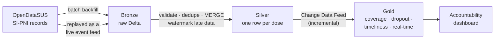

# Real-Time SUS Vaccination Lakehouse

> **Does every municipality reach its vaccination targets — and register doses on time?**
> A bronze/silver/gold lakehouse on public Brazilian health data (SUS / SI-PNI), with batch
> and simulated real-time ingestion in PySpark + Delta Lake, data contracts, quality gates,
> partition-skew analysis, catalog and lineage.

---

## The problem

Brazil's public health system (SUS) registers every vaccine dose applied in the country.
Municipalities are accountable for reaching the National Immunisation Programme (PNI)
coverage targets and for registering doses promptly — but the open data is large, messy
and arrives late: duplicates, invalid codes, two municipality-code formats, and doses that
reach the national system days or weeks after they were applied.

## What this project builds

- **Batch + streaming with one engine** — Spark Structured Streaming, `availableNow` for backfill, micro-batches for the live feed
- **Incremental and idempotent** — checkpoints, Delta MERGE, idempotent stream writes, re-runs change nothing
- **Data contracts** (ODCS) → schemas, quality rules and docs generated from one source of truth
- **Quality gates** with Great Expectations — completeness, validity, uniqueness at every layer
- **Partitioning & skew** — São Paulo vs Espírito Santo as a real skew case, measured in the Spark UI
- **Catalog & lineage** — OpenLineage events, Delta history as audit trail, LGPD-aware publishing

## Status

🚧 **Planning complete, implementation starting.** The full design lives in [`docs/`](docs/):

- [Architecture](docs/ARCHITECTURE.md) — design and market-standard conventions per technology
- [Backlog](docs/README.md) — 12 features, 63 tasks
- [Architecture Decision Records](docs/adr/)

## Data

Public, anonymised data from the Brazilian Ministry of Health (OpenDataSUS — SI-PNI),
IBGE and SINASC. No raw records are stored in this repository. See
[ADR-0003](docs/adr/0003-public-sus-vaccination-data.md).

## License

Code: [MIT](LICENSE). Data remains under the terms of its original publishers.
