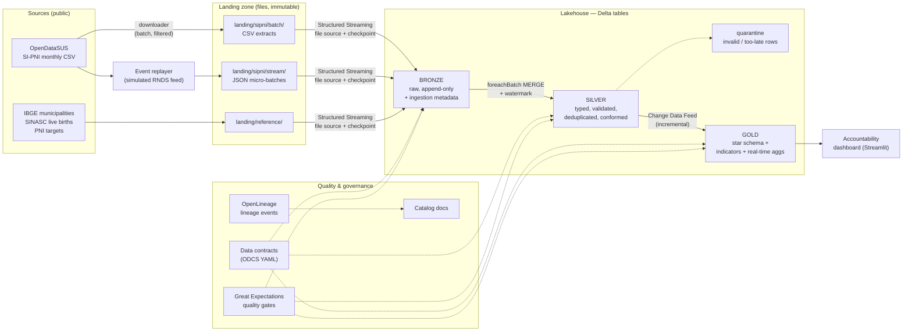
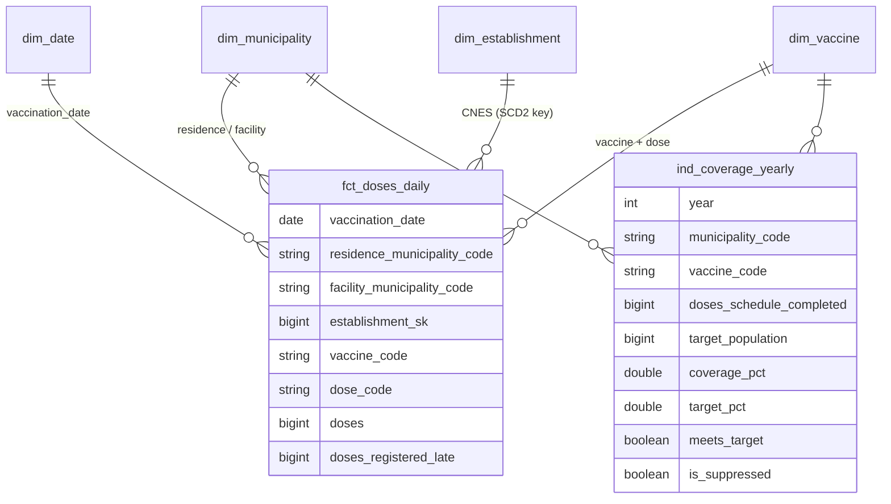
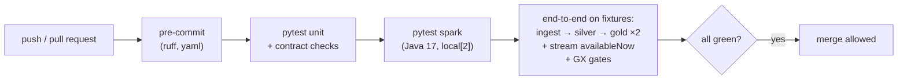

# Architecture — Real-Time SUS Vaccination Lakehouse

> **Status:** Draft v0.1 · **Owner:** project author · **Last review:** 2026-11-25
>
> This document is the single source of truth for *how* the project is built.
> Every feature and task in [`docs/features`](features/) and [`docs/tasks`](tasks/)
> must follow it. When a decision here changes, record it as an
> [Architecture Decision Record](adr/) first, then update this file.

---

## 1. Context and goals

### 1.1 Business problem

Brazil's public health system (**SUS**) records every vaccine dose applied in the
country. Health facilities send each record to the national health data network
(**RNDS**), which feeds the National Immunisation Programme information system
(**SI-PNI**). The Ministry of Health publishes these records, anonymised, on
**OpenDataSUS**.

Municipalities are **accountable** for reaching the vaccination coverage targets of
the National Immunisation Programme (PNI) — typically 95 % for childhood vaccines —
and for registering doses *on time*, because the data drives stock distribution,
outbreak response and public scrutiny. In practice, managers struggle with:

- **Late data** — a dose applied on Monday may only reach the national system days or weeks later, so "today's" numbers are always incomplete.
- **Messy data** — duplicates, invalid codes, municipality codes in two formats (6 vs 7 digits), inconsistent dose descriptions.
- **No single trusted number** — coverage, dropout and timeliness are computed differently in different spreadsheets.

The project builds a **lakehouse** that turns the raw SI-PNI records into trusted,
tested, documented indicators, in **batch** (historical backfill) and in
**near real time** (a simulated live feed), and answers four questions:

1. **Coverage** — Which municipalities reach the PNI target for each childhood vaccine, and which fall short? (accountability)
2. **Dropout** — Where do children start a multi-dose schedule but not finish it (dropout rate D1 → D3)?
3. **Timeliness** — How long does a dose take from application to national registration, per municipality and facility? Who registers late?
4. **Operations** — What is being applied *right now*, per municipality and hour, while correctly handling late and duplicate events?

### 1.2 Why "IoT"?

The project is the portfolio's *IoT lakehouse*. The pattern is the same as in
industrial IoT, only the domain changes:

| IoT concept | In this project |
|---|---|
| Device / sensor | Health facility (identified by its **CNES** code) |
| Telemetry event | One vaccination record (one dose) |
| Message hub (IoT Hub, Kafka) | RNDS → simulated by an **event replayer** writing JSON micro-batches |
| Event time vs. ingestion time | Date of vaccination vs. date the record reached RNDS |
| Late / duplicated telemetry | Late registrations, records resent by the source system |
| Device registry | CNES establishment dimension (slowly changing) |

Everything learned here (watermarks, exactly-once sinks, skew, compaction) transfers
directly to sensor data on Microsoft Fabric, Databricks or Azure IoT.

### 1.3 Quality goals (non-functional requirements)

| Priority | Quality attribute | What it means here |
|---|---|---|
| 1 | **Correctness under failure** | Any step can be re-run or crash mid-way without duplicating or losing doses (idempotent, exactly-once). |
| 2 | **Traceability** | Every indicator can be traced to the bronze rows and source files it came from (lineage, Delta history). |
| 3 | **Data quality by design** | Contracts and quality gates run in the pipeline; bad data is quarantined, never silently dropped. |
| 4 | **Privacy (LGPD)** | Health data is *sensitive personal data*. Only what the indicators need is kept; small counts are suppressed in published outputs. |
| 5 | **Reproducibility** | `git clone` → documented commands → same tables. Pinned dependencies, fixture sample for CI. |
| 6 | **Laptop-scale cost** | Runs on an 8 GB laptop (WSL2) and in free GitHub Actions; no paid cloud account required. |

### 1.4 Constraints

- **Public, anonymised data only** (OpenDataSUS). No attempt at re-identification. See [ADR-0003](adr/0003-public-sus-vaccination-data.md).
- National monthly files are 1.5–3.1 GB zipped (6–12 GB of CSV, 10–21 M rows; [sources](data/sources.md)), so the default scope is **one region (Southeast: SP, MG, RJ, ES) and 24 months**, configurable. The scope is deliberately skewed (São Paulo ≫ Espírito Santo) to study partition skew.
- Spark needs Java 17 and a Linux environment: development runs in **WSL2 Ubuntu** on an 8 GB laptop (WSL capped at 5 GB); visitors can use **GitHub Codespaces** through the dev container; see [ADR-0010](adr/0010-wsl2-for-development-dev-container-for-visitors.md).
- Python 3.11. All code, docs and table/column names in **English**; Portuguese source names are mapped in the data contract.

---

## 2. Solution overview

The project follows the **medallion architecture** (bronze → silver → gold) on
**Delta Lake** tables processed with **PySpark** — the same pattern used by
Microsoft Fabric Lakehouses and Databricks. See
[ADR-0002](adr/0002-delta-lake-medallion-on-pyspark.md).



### 2.1 Layers

| Layer | Responsibility | Rules |
|---|---|---|
| **Landing** (`data/landing/`) | Files exactly as received (CSV extracts, JSON event files, reference files) + a manifest with checksums | Immutable once written. Never edited by hand. Files are written to a temp name and **atomically renamed** so readers never see half-written files. |
| **Bronze** | A faithful copy of the source in Delta, **all columns as strings**, plus `_ingested_at`, `_source_file`, `_file_hash`, `_batch_id` | Append-only. No business logic. Lets us rebuild silver at any time ("replayability"). |
| **Silver** | One row per dose (business key `dose_id`): typed, renamed to English, codes standardised, validated, deduplicated, conformed with reference data | Invalid rows go to `silver.quarantine_doses` with a reason. Writes are **MERGE** upserts → idempotent. |
| **Gold** | Business-level star schema and indicators: coverage, dropout, timeliness, near-real-time hourly doses | Built incrementally from silver's Change Data Feed. Only gold is read by the dashboard. Small counts are suppressed. |

> **Why bronze keeps strings?** If bronze casts types, a single malformed date
> makes the whole load fail or, worse, silently becomes `null`. Keeping the raw
> text means we can always see *what the source really sent* and fix the cast
> in silver, then rebuild. This is the "schema-on-read at the edge, schema-on-write
> in the core" principle.

### 2.2 One engine for batch and streaming (Kappa-style)

Historical months (backfill) and the live feed use **the same Spark Structured
Streaming code**. Batch is just a stream started with `trigger(availableNow=True)`,
which processes all new files and stops. This is the pattern Databricks calls
*Auto Loader* and Fabric uses in its Spark streaming jobs.

| Path | Input | Trigger | Why |
|---|---|---|---|
| Backfill | Monthly CSV extracts | `availableNow=True` | Process everything new, then stop — a "batch" with streaming bookkeeping (checkpoint = which files were already loaded). |
| Live feed | JSON micro-batches from the replayer | `processingTime="10 seconds"` | Near-real-time micro-batches. |
| Tests / CI | Fixture files | `availableNow=True` | Deterministic: the test waits until the query finishes. |

The alternative, **Lambda architecture** (separate batch and speed code paths
merged at query time), duplicates logic and is a frequent source of "the
real-time number does not match the daily report". Kappa-style avoids that.

### 2.3 Simulated real-time feed

The replayer ([F04](features/F04-streaming-simulation.md)) turns real records
into a realistic event stream:

- Records of the "live" months are emitted in **event-time order**, accelerated by a speed factor (e.g. 1 simulated day = 30 s).
- The **delay** of each event is taken from the *real* gap between vaccination date and RNDS registration date, so late data is authentic, not invented.
- Configurable injection of **duplicates** (at-least-once delivery) and **out-of-order** events.
- Deterministic with a seed.

Source records carry only a vaccination *date*; a time of day inside facility
opening hours is synthesised for the hourly real-time view. This is a documented
simulation assumption and never affects the daily/yearly indicators.

---

## 3. Technology stack

| Concern | Choice | Why (market context) | ADR |
|---|---|---|---|
| Language | **Python 3.11** | Standard for data engineering + data science. | — |
| Processing engine | **Apache Spark 4.x (PySpark)**, local mode | De-facto standard for distributed data processing; the engine behind Databricks, Microsoft Fabric, Synapse, EMR, Dataproc. Local mode runs the same code on one machine. | [0002](adr/0002-delta-lake-medallion-on-pyspark.md) |
| Table format | **Delta Lake** (`delta-spark`, version matched to Spark) | Adds ACID transactions, MERGE, time travel, schema enforcement and Change Data Feed on top of Parquet. Native format of Fabric OneLake and Databricks. | [0002](adr/0002-delta-lake-medallion-on-pyspark.md) |
| File format | **Parquet** (inside Delta), CSV/JSON in landing | Columnar, compressed, statistics per file for data skipping. | — |
| Streaming | **Spark Structured Streaming** (file source, Delta source/sink) | Same DataFrame API for batch and stream; exactly-once with checkpoints + idempotent sinks. Kafka optional. | [0004](adr/0004-file-based-streaming-simulation.md) |
| Data contracts | **Open Data Contract Standard (ODCS) v3.2.0** YAML, validated against the official JSON Schema | Vendor-neutral standard (Linux Foundation / Bitol) for schema, quality rules, SLAs and ownership. | [0006](adr/0006-odcs-data-contracts.md) |
| Data quality | **Great Expectations (GX Core 1.x)** on Spark DataFrames | Most widely adopted open-source DQ framework; expectations double as documentation (Data Docs). Soda is the main alternative. | [0005](adr/0005-great-expectations-for-data-quality.md) |
| Lineage | **OpenLineage** Spark listener | Open standard for lineage events, consumed by Marquez, DataHub, Microsoft Purview, Unity Catalog. | [0008](adr/0008-openlineage-for-lineage.md) |
| Catalog | Spark SQL catalog (local Hive-compatible metastore) + catalog docs generated from contracts | Same `database.table` model as Unity Catalog / Fabric; "catalog as code". | [0008](adr/0008-openlineage-for-lineage.md) |
| Serving / dashboard | **delta-rs** (`deltalake`) + **DuckDB** + **Streamlit** | Reading gold does not need a Spark cluster; lightweight readers keep the app fast. | — |
| CLI | **Typer** | Typed, self-documenting command-line interface. | — |
| Config | **pydantic-settings** + YAML profiles (`conf/dev.yaml`, `conf/ci.yaml`) | Validated settings, 12-factor environment overrides. | — |
| Packaging | `pyproject.toml` (PEP 621) + `src/` layout, pins in `requirements-lock.txt` (pip-tools) | Python packaging standard. | — |
| Testing | **pytest** (+ `pyspark.testing.assertDataFrameEqual`), GX suites | Code tested with pytest, data tested with GX. | — |
| Lint / format | **ruff**, **pre-commit** | One fast tool for lint + format; hooks keep CI green. | — |
| CI | **GitHub Actions** (Ubuntu, Java 17) | Free for public repos; runs Spark tests on a fixture sample. | — |
| Dev environment | **WSL2 Ubuntu** (development) + **dev container** for GitHub Codespaces (visitors) | Spark runs on Linux, as in industry, with no Windows `winutils` issues. The dev container is the standard way to make an environment reproducible ("environment as code") and gives reviewers a one-click environment. | [0010](adr/0010-wsl2-for-development-dev-container-for-visitors.md) |

> **Versions.** Spark and Delta Lake must be a compatible pair (see the
> [Delta Lake releases / compatibility table](https://docs.delta.io/latest/releases.html)).
> Exact versions are fixed in F01-T03 and recorded in `requirements-lock.txt`.

---

## 4. Repository layout

```text
sus-vaccination-lakehouse/
├── .devcontainer/devcontainer.json   # dev container for Codespaces / VS Code (Java 17 + Python 3.11)
├── .github/
│   ├── workflows/ci.yml              # lint → unit → spark tests → end-to-end sample
│   └── pull_request_template.md
├── conf/
│   ├── base.yaml                     # scope (UFs, months), paths, Spark settings
│   ├── dev.yaml                      # development overrides (small scope, readable logs)
│   └── ci.yaml                       # tiny fixture scope
├── contracts/                        # ODCS data contracts — the schema source of truth
│   ├── source/sipni_doses.odcs.yaml
│   ├── bronze/…  silver/…  gold/…
├── gx/                               # Great Expectations project (suites, checkpoints)
├── data/                             # ⚠ git-ignored, reproducible
│   ├── landing/{sipni/batch,sipni/stream,reference}/
│   ├── lakehouse/{bronze,silver,gold}/   # Delta tables
│   ├── checkpoints/<query_name>/         # streaming state, one folder per query
│   └── metastore/                        # local Spark catalog
├── dashboard/app.py                  # Streamlit accountability dashboard
├── docs/
│   ├── README.md                     # backlog index and workflow
│   ├── ARCHITECTURE.md               # this file
│   ├── adr/  features/  tasks/  templates/
│   ├── data/                         # sources, data dictionary, methodology, data card, privacy
│   ├── catalog/                      # generated table docs
│   ├── setup.md   runbook.md         # environment setup · operations (backfill, late data, retention)
│   ├── quality.md   report.md        # quality scorecard · final technical report
│   ├── lineage.md                    # generated from OpenLineage events
│   └── performance.md                # partitioning / skew / compaction experiments
├── notebooks/                        # numbered, thin: exploration only, logic lives in src/
├── scripts/                          # dev/CI helpers (contract compatibility, lineage docs, checks)
├── seeds/                            # small versioned reference CSVs with citations (PNI targets, code maps)
├── src/vaccination_lakehouse/
│   ├── cli.py                        # `vaxlake` entry point (Typer)
│   ├── config.py   logging_setup.py   spark.py   # SparkSession factory
│   ├── contracts/                    # load ODCS YAML → StructType, rule checks
│   ├── ingestion/                    # download.py, landing.py, bronze_batch.py, reference.py
│   ├── streaming/                    # replayer.py, bronze_stream.py, listeners.py
│   ├── silver/                       # transforms.py, validate.py, merge.py, establishments.py
│   ├── gold/                         # model.py, coverage.py, dropout.py, timeliness.py, realtime.py
│   ├── quality/                      # gx runner, gates, scorecard
│   ├── governance/                   # catalog registration, lineage docs, retention
│   └── ops/                          # run log, optimize/vacuum jobs
└── tests/
    ├── fixtures/                     # tiny hand-made CSV/JSON samples (no real people)
    ├── unit/                         # pure functions, no Spark
    ├── spark/                        # transformations with a local SparkSession
    └── integration/                  # landing → gold on fixtures, idempotency, restart
```

---

## 5. Data model

### 5.1 Sources

| Source | Content | Grain | Frequency | Use |
|---|---|---|---|---|
| **SI-PNI doses applied** (OpenDataSUS) | Anonymised individual vaccination records, 56 columns, Latin-1 `;` CSV in monthly ZIPs; past months are re-published | One dose | Monthly files, national | Facts |
| **IBGE municipalities** | Municipality code (7 digits), name, UF, region | Municipality | Yearly | Dimension, code conformance |
| **SINASC live births** (OpenDataSUS) | Live births by municipality of residence; microdata aggregated to counts at ingestion | Municipality × year | Yearly (current year preliminary) | Coverage denominator (children < 1 and 1 year old) |
| **Coverage indicators, vaccines, doses** (seeds, [`seeds/README.md`](../seeds/README.md)) | Per indicator: vaccines that count, doses required, target age, minimum interval, target (BCG/rotavirus 90 %, others 95 %); vaccine and dose code tables | Indicator / code | Rarely changes | Indicator rules and thresholds |

Exact URLs, file names, encoding and columns are confirmed in
[F02-T01](tasks/F02-T01-source-discovery.md) and documented in
`docs/data/sources.md`. Nothing in the code may assume a column exists before it
is in the data contract.

### 5.2 Main tables

| Table | Layer | Grain / key | Partitioned by | Notes |
|---|---|---|---|---|
| `bronze.sipni_doses_raw` | Bronze | one source row · `_source_file` + row | `_ingest_date` | All strings, batch path |
| `bronze.sipni_dose_events_raw` | Bronze | one event · `event_id` | `_ingest_date` | Stream path, JSON envelope |
| `bronze.ref_*` | Bronze | per file | — | Reference data |
| `silver.vaccination_doses` | Silver | one dose · `dose_id` | `vaccination_month` | Unified batch + stream, MERGE, CDF on |
| `silver.quarantine_doses` | Silver | one rejected row | `_ingest_date` | `reject_reason`, original payload |
| `silver.late_arrivals` | Silver | one too-late event | `_ingest_date` | Beyond streaming watermark; reconciled by batch |
| `silver.dim_establishment` | Silver | CNES × validity period | — | SCD Type 2 (`valid_from`, `valid_to`, `is_current`) |
| `gold.dim_municipality` · `dim_vaccine` · `dim_date` · `dim_establishment` | Gold | one member | — | Conformed dimensions |
| `gold.fct_doses_daily` | Gold | municipality × establishment × vaccine × dose × date | `year` | Additive counts |
| `gold.ind_coverage_yearly` | Gold | municipality × vaccine × year | — | Coverage %, target, `meets_target` |
| `gold.ind_dropout_yearly` | Gold | municipality × vaccine × year | — | Dropout % and PNI class (low/medium/high) |
| `gold.ind_timeliness_monthly` | Gold | municipality (and establishment) × month | — | Registration lag p50/p90, % registered within N days |
| `gold.rt_doses_hourly` | Gold | municipality × vaccine × 1-hour window | — | Streaming aggregate with watermark |
| `ops.run_log` · `ops.quality_results` · `ops.stream_metrics` | Ops | one step run / expectation result / micro-batch | `run_date` | Observability |
| `ops.watermarks` | Ops | one consumer table | — | Last silver version processed by each gold build (incremental bookkeeping) |

### 5.3 Gold star schema



### 5.4 Indicator definitions (PNI methodology, summarised)

| Indicator | Formula | Notes |
|---|---|---|
| **Vaccination coverage** | **individuals** who completed the schedule in the target age group ÷ target population × 100 | Official method since 2024 (NT 90/2025-DPNI): stage 1 = enough doses respecting age and minimum interval; stage 2 = last dose by "dose type"; each person once (needs `patient_key`). Denominator for < 1 and 1-year-olds = SINASC live births. Counted by municipality of **residence**. Can exceed 100 % — reported, not capped. The share of stage-2 people is reported as a data-quality indicator. |
| **Dropout rate** | (first doses − last doses) ÷ first doses × 100 | Class: low < 5 %, medium 5–10 %, high ≥ 10 %. |
| **Homogeneity** | % of municipalities (in a UF) that reach the target for a vaccine | Equity view of coverage. |
| **Registration timeliness** | `registered_at − vaccination_date` in days | p50, p90 and % within 7/30 days, per municipality and facility. |

The exact methodology (age ranges, which dose code completes each schedule) is
written in `docs/data/indicator_methodology.md` in F06-T03 and reconciled with
the Ministry's official panel in F06-T06.

### 5.5 Identity, keys and conformance

- **Business key** of a dose: the RNDS document identifier `co_documento` → `dose_id`. Duplicates are resolved by keeping the most recently registered version, and a document that **replaces** another (`co_troca_documento`) retires the replaced one — the source has update semantics, not only inserts.
- **Surrogate keys** in gold dimensions (`*_sk`, `xxhash64` of the natural key + validity start) — deterministic, so rebuilds produce the same keys.
- **Municipality codes:** DATASUS uses 6 digits, IBGE 7 (the 7th is a check digit). Silver stores **both** (`municipality_code_6`, `municipality_code_7`) and joins always use the 6-digit form. This is one of the most common errors in Brazilian health data.

---

## 6. Conventions and best practices by technology

### 6.1 Python

- PEP 8 via `ruff format` + `ruff check` (line length 100); type hints on public functions; Google-style docstrings.
- **I/O at the edges.** Transformations are pure functions `def f(df: DataFrame) -> DataFrame`; reading/writing lives in a thin job layer. This makes every transform unit-testable.
- No hard-coded paths, UFs, dates or thresholds — they come from `conf/*.yaml` through `config.py`.
- Specific exceptions (`ContractViolationError`, `SourceUnavailableError`); never a bare `except:`.
- `logging` with structured (JSON) output in jobs, never `print`.
- HTTP downloads: timeouts, retries with exponential backoff, a generic `User-Agent`, and polite request rates — public servers are shared infrastructure.

### 6.2 PySpark

| Rule | Why |
|---|---|
| **Always pass an explicit schema** (`StructType` generated from the contract); never `inferSchema=True` | Inference reads the data twice and guesses differently per file; explicit schemas make drift visible. |
| Prefer **built-in functions** (`F.when`, `F.to_date`, `F.regexp_replace`) over Python UDFs | UDFs serialise each row to Python and block Catalyst optimisations — often 10–100× slower. If unavoidable, use a vectorised `pandas_udf`. |
| Chain transforms with **`DataFrame.transform`** | Readable pipelines of small, named, tested functions. |
| Add several columns at once with **`withColumns({...})`**, not long chains of `withColumn` | Each `withColumn` adds a projection to the plan; long chains slow down planning (warned in the PySpark docs). |
| **Never `collect()` / `toPandas()`** a large DataFrame | Pulls all data into the driver → out-of-memory. Only for small aggregates. |
| **Column names:** `snake_case`, English, suffixes `_at` (timestamp), `_date`, `_code`, `_pct`; booleans `is_` / `has_`; technical columns start with `_` | Consistent, self-describing schema. |
| Use **`spark.sql.session.timeZone = America/Sao_Paulo`** explicitly; store timestamps as UTC-aware types | Avoids silent off-by-one-day errors in daily aggregates. |
| Keep **Adaptive Query Execution (AQE)** on; broadcast small dimensions explicitly (`F.broadcast`) | AQE fixes many skew and partition-size problems at runtime. |
| `repartition` / `coalesce` only with a measured reason | Each shuffle costs time; document why it is there. |
| One `SparkSession` factory (`spark.py`) with Delta extensions configured | Same configuration in jobs, tests and notebooks. |

```python
# silver/transforms.py — the style every transform follows
def standardise_municipality(df: DataFrame) -> DataFrame:
    """Normalise residence municipality to 6-digit DATASUS + 7-digit IBGE codes."""
    code = F.regexp_replace(F.col("residence_municipality_raw"), r"\D", "")
    return df.withColumns(
        {
            "municipality_code_6": F.substring(code, 1, 6),
            "is_municipality_code_valid": F.length(code).isin(6, 7),
        }
    )


silver_df = (
    bronze_df.transform(rename_to_english)
    .transform(cast_types)
    .transform(standardise_municipality)
    .transform(add_registration_lag)
)
```

### 6.3 Delta Lake

| Practice | How we apply it |
|---|---|
| **ACID + MERGE for upserts** | Silver is written with `MERGE INTO … ON dose_id` — re-processing the same data changes nothing. |
| **Idempotent writes from streams** | In `foreachBatch`, writes use the `txnAppId` / `txnVersion` options (= query id / batch id), so a retried micro-batch is skipped by Delta. |
| **Schema enforcement** on, `mergeSchema` **off** by default | A new or renamed source column fails loudly; schema evolution is a reviewed change to the contract (new contract version), not an accident. |
| **Change Data Feed** on silver | Gold reads only the rows that changed since its last run. |
| **Partition only low-cardinality, query-filtered columns**, aiming at partitions ≥ ~1 GB in production | Over-partitioning creates the *small files problem*. At our scale we partition silver by month only, and we demonstrate why partitioning by UF or municipality is harmful (F08). Liquid clustering is evaluated as the modern alternative. |
| **Compaction** (`OPTIMIZE`) after streaming, **Z-ORDER / clustering** on common filters | Streaming writes many small files; compaction restores read performance. |
| **`VACUUM` with a retention ≥ 7 days** | Removes unreferenced files without breaking time travel or running streams. |
| **Time travel & `DESCRIBE HISTORY`** as audit trail | Who wrote what, when, with which operation — part of accountability. |
| Table properties document ownership | `TBLPROPERTIES ('owner'=…, 'contract_version'=…, 'layer'=…)`. |

### 6.4 Structured Streaming

| Practice | Why |
|---|---|
| **One checkpoint folder per query**, never shared, never deleted casually | The checkpoint *is* the query's memory (offsets + state). Deleting it means re-processing; sharing it corrupts both queries. |
| Changing a query's logic may require a **new checkpoint** — follow the [compatibility rules](https://spark.apache.org/docs/latest/streaming/apis-on-dataframes-and-datasets.html#recovery-semantics-after-changes-in-a-streaming-query) | Not every change is restart-safe (e.g. changing aggregation keys). |
| **Exactly-once = replayable source + checkpoint + idempotent sink** | Files and Delta are replayable sources; Delta is an idempotent sink. |
| **Watermarks** on event time for stateful operations (dedup, windows) | Bounds the state kept in memory and defines "how late is too late". |
| Events later than the watermark are **not lost**: they land in `silver.late_arrivals` and are reconciled by the batch path | Real-time numbers are provisional; batch numbers are final. Say so in the dashboard. |
| `maxFilesPerTrigger` to bound micro-batch size | Predictable latency and memory. |
| A **`StreamingQueryListener`** logs progress metrics | Input rate, processing rate, batch duration and watermark are the first things an on-call engineer looks at. |
| Atomic file writes in the landing zone (write temp → rename) | The file source must never read a half-written file. |

### 6.5 Data contracts (ODCS)

- One contract per table and per source in `contracts/` ([conventions](../contracts/README.md)), ODCS v3.2.0 YAML: schema (name, type, nullability, description, source column via `transformSourceObjects`), primary key, quality rules, freshness SLA, owner, privacy classification. `scripts/validate_contracts.py` checks them against the official JSON Schema in every test run.
- The contract is the **single source of truth**: Spark schemas, GX expectations, table/column comments and catalog docs are **generated** from it. No schema is written twice.
- **Semantic versioning:** removing/renaming/retyping a column = *major* (breaking); adding a nullable column = *minor*; descriptions = *patch*. CI fails a breaking change without a major bump.
- Bronze contract mirrors the source; silver/gold contracts describe what consumers can rely on.

### 6.6 Data quality (Great Expectations)

Quality is checked at every layer ("defence in depth"):

| Layer | Dimension | Example expectations | Severity |
|---|---|---|---|
| Landing / bronze | **Completeness** of the file | expected columns present; row count > 0 and within ±X % of the manifest | critical |
| Silver | **Validity** | vaccination date not in the future and ≥ 2020; municipality code valid; vaccine and dose codes in the reference set; age 0–130 | critical (row-level → quarantine) |
| Silver | **Uniqueness** | `dose_id` unique | critical |
| Silver | **Completeness** of fields | `residence_municipality_code` not null in ≥ 98 % of rows | warning |
| Gold | **Consistency** | sum of `fct_doses_daily` = silver count for the same period; coverage ≥ 0 | critical |
| Gold | **Timeliness** | latest `vaccination_date` not older than the freshness SLA | warning |

- **Critical** failures stop the step (nothing is written downstream); **warnings** are logged in `ops.quality_results` and shown in the scorecard.
- Row-level validity is enforced in Spark (quarantine); GX validates the resulting table. GX does not replace transformation logic — it verifies it.
- Results are kept over time (trend), and GX **Data Docs** are generated as human-readable documentation.

### 6.7 Partitioning and skew

- **Skew** = some partitions/keys hold much more data than others (São Paulo holds about half of the Southeast population, Espírito Santo under 5 %). In Spark, one task then runs much longer than the rest and the whole stage waits for it.
- Diagnose in the **Spark UI** (task duration max vs. median, shuffle read size per task) before fixing anything.
- Tools, in order of preference: **AQE skew-join handling** (automatic) → **broadcast** the small side → **salting** the hot key → change the partitioning key.
- Never partition a table by a skewed, high-cardinality key (municipality, establishment).
- All experiments are recorded with numbers in `docs/performance.md`.

### 6.8 Catalog, lineage and governance

- Tables are registered in the Spark catalog as `bronze.*`, `silver.*`, `gold.*`, `ops.*` with table and column **comments generated from contracts**.
- **OpenLineage** emits a lineage event for each Spark job (inputs, outputs, column lineage); `docs/lineage.md` is generated from those events. Marquez can display them (optional).
- **Delta history** is the audit trail; `docs/data/data_card.md` documents provenance, intended use, limitations and ownership.
- **LGPD** (Lei 13.709/2018): health data is *sensitive personal data* (art. 5, II and art. 11). The source is called anonymised, but it has a stable pseudonymous patient code and quasi-identifiers: in the samples, *municipality + date + age + sex* makes 69 % of records unique. The [privacy assessment](data/privacy_assessment.md) defines rules P1–P11, mainly:
  - **minimisation** — silver keeps 35 of 56 columns; all sensitive columns and the CEP prefix are dropped; `patient_key` stays in silver (the official coverage method needs it) and never reaches gold;
  - **small-cell suppression** — published counts below *k* = 5 (`privacy.suppression_threshold`), and coverages whose numerator or complement is below *k*, are suppressed;
  - no record-level data outside the lakehouse, and no joins with other data aimed at identifying people.

### 6.9 Git workflow

- **Trunk-based**: `main` always green; short branches `feat/F03-T04-incremental-ingestion`.
- **Conventional Commits** (`feat(F04-T02): replay events in event-time order`); one task ≈ one branch ≈ one PR; feature branches collect task branches as in project 1.
- Never commit data, checkpoints, the metastore, `.env` or notebook outputs with personal paths.
- **Semantic Versioning** for releases and a `CHANGELOG.md` (Keep a Changelog).

### 6.10 Testing strategy

| Level | Scope | Example | Folder |
|---|---|---|---|
| Unit | pure Python | contract → `StructType`; replayer ordering; lag computation | `tests/unit` |
| Spark | one transform on tiny DataFrames | `standardise_municipality` handles 6/7 digits and garbage | `tests/spark` |
| Data | a table | GX suites on fixture outputs | `gx/` |
| Integration | several layers | landing → gold on fixtures; **run twice → identical tables**; kill a stream mid-way and restart → no duplicates | `tests/integration` |

- One **session-scoped** SparkSession fixture (`local[2]`, few shuffle partitions) keeps the suite fast.
- Fixtures are small hand-made files with fictitious values — no real records in the repo.
- Target ≥ 80 % line coverage on `src/`.

### 6.11 Configuration and security

- Settings: `conf/base.yaml` + environment profile + environment variables (`VAXLAKE_*`), validated with pydantic.
- No secrets are needed (public data). The `.env` pattern is still used and `.env` is git-ignored.
- Spark driver memory defaults to 3 GB, which fits WSL2 capped at 5 GB on an 8 GB laptop (and a 2-core / 8 GB codespace).

---

## 7. Runtime view (how to run)

```bash
# in WSL2 Ubuntu, after the one-time `bash scripts/wsl_setup.sh` (docs/setup.md)
vaxenv                                              # activate the venv, go to the repository
# (visitors: "Open in GitHub Codespaces" - the dev container installs everything)

vaxlake download --months 2024-01:2025-06          # → data/landing/sipni/batch (filtered to scope UFs)
vaxlake reference                                   # IBGE, SINASC, PNI targets → bronze.ref_*
vaxlake ingest                                      # landing → bronze (availableNow, idempotent)
vaxlake silver                                      # bronze → silver (MERGE) + quality gate
vaxlake gold                                        # silver CDF → gold indicators + quality gate

# real-time simulation (two terminals)
vaxlake replay --month 2025-07 --speed 2880         # 1 day ≈ 30 s
vaxlake stream                                      # stream → bronze → silver → gold.rt_doses_hourly

vaxlake optimize                                    # OPTIMIZE / VACUUM maintenance
streamlit run dashboard/app.py
```

Every command is **idempotent**: running it twice gives the same tables.

---

## 8. CI/CD



CI never downloads from OpenDataSUS (slow, external dependency); it uses fixtures.
The Ivy cache (`~/.ivy2`) is cached so Delta/OpenLineage jars are not re-downloaded.

---

## 9. Risks and technical debt

| Risk | Mitigation |
|---|---|
| Source URLs, columns or encoding change | Contract + discovery doc; downloader fails loudly on unexpected schema; fixtures pin behaviour. |
| Files too large for an 8 GB laptop | Filter to scope UFs while downloading; stream-process CSV; configurable scope; CI uses fixtures. |
| Spark on Windows friction | WSL2 as the development environment, dev container for visitors (ADR-0010). |
| WSL2 and dev container drift apart | Same Java/Python versions and the same lock file in both; CI checks the result. |
| Windows slows down during heavy runs (8 GB shared) | WSL capped at 5 GB, driver ≤ 3 GB, small default scope; fixtures let most work run with little data. |
| Indicators differ from official numbers | Reconciliation task (F06-T06) documents and explains each difference instead of hiding it. |
| Re-identification risk | Minimisation, suppression, privacy assessment (F02-T06). |
| Over-engineering | Every component must serve one of the four business questions; Kafka/Marquez are optional. |
| Library API churn (GX 1.x, Spark 4) | Pin versions; wrap third-party APIs behind small modules (`quality/`, `governance/`). |

---

## 10. Glossary

| Term | Meaning |
|---|---|
| **SUS** | *Sistema Único de Saúde* — Brazil's universal public health system. |
| **PNI / SI-PNI** | National Immunisation Programme / its information system. |
| **RNDS** | *Rede Nacional de Dados em Saúde* — national health data network receiving the records. |
| **CNES** | National registry of health establishments (facility code). |
| **SINASC** | Live-birth information system — denominator for infant coverage. |
| **IBGE code** | 7-digit municipality code (DATASUS uses the first 6). |
| **UF** | *Unidade Federativa* — Brazilian state. |
| **Medallion** | Bronze (raw) → silver (clean) → gold (business) layering. |
| **Delta Lake** | Open table format: Parquet files + a transaction log (`_delta_log`). |
| **Checkpoint** | Folder where a streaming query stores progress and state to recover after failure. |
| **Watermark** | Threshold of event time after which late data is no longer accepted by a stateful operation. |
| **Idempotent** | Running an operation multiple times has the same effect as running it once. |
| **Exactly-once** | Each input record affects the output exactly once, even across failures and retries. |
| **Skew** | Uneven distribution of data across partitions/keys. |
| **CDF** | Delta *Change Data Feed* — row-level changes between table versions. |
| **SCD Type 2** | Slowly changing dimension that keeps history with validity periods. |
| **Data contract** | Agreement on a dataset's schema, quality and SLAs between producer and consumer. |
| **Small-cell suppression** | Hiding counts below a threshold to reduce re-identification risk. |
