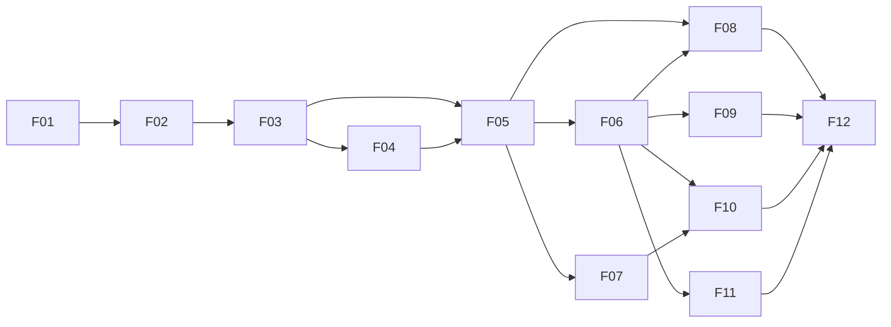

# Project documentation — Real-Time SUS Vaccination Lakehouse

This folder is the project's planning and design space. It follows a lightweight
**Kanban** workflow: every piece of work is a *feature* broken into *tasks*,
each in its own Markdown file, versioned with the code.

## Contents

| Path | What it is |
|---|---|
| [ARCHITECTURE.md](ARCHITECTURE.md) | How the system is built and the conventions every task follows |
| [adr/](adr/) | Architecture Decision Records — *why* key choices were made |
| [features/](features/) | One file per feature (goal, scope, acceptance criteria, task list) |
| [tasks/](tasks/) | One file per task (steps, acceptance criteria, deliverables, best practice) |
| [data/](data/) | Source documentation, data dictionary, methodology, data card, privacy assessment |
| [templates/](templates/) | Templates for new features, tasks and ADRs |

## Architecture decisions

| ADR | Decision |
|---|---|
| [0001](adr/0001-record-architecture-decisions.md) | Record architecture decisions |
| [0002](adr/0002-delta-lake-medallion-on-pyspark.md) | Medallion architecture on Delta Lake with PySpark |
| [0003](adr/0003-public-sus-vaccination-data.md) | Public SUS vaccination data (SI-PNI) as the data source |
| [0004](adr/0004-file-based-streaming-simulation.md) | File-based streaming simulation (Kafka optional) |
| [0005](adr/0005-great-expectations-for-data-quality.md) | Great Expectations for data quality |
| [0006](adr/0006-odcs-data-contracts.md) | Data contracts in the Open Data Contract Standard |
| [0007](adr/0007-github-codespaces-dev-environment.md) | ~~GitHub Codespaces as the development environment~~ (superseded by 0010) |
| [0008](adr/0008-openlineage-for-lineage.md) | OpenLineage for lineage, catalog as code |
| [0009](adr/0009-spark-and-delta-version-pins.md) | Pin Spark 4.1 with Delta Lake 4.4 |
| [0010](adr/0010-wsl2-for-development-dev-container-for-visitors.md) | WSL2 for development, dev container for visitors |

## Backlog

**12 features · 63 tasks · ~143 h estimated** (including one optional *Could* task, F04-T06, 3 h)

| ID | Feature | Priority | Depends on | Tasks | Estimate | Status |
|---|---|---|---|---|---|---|
| [F01](features/F01-project-setup.md) | Project setup & engineering standards | Must | — | 7 | 12 h | Done |
| [F02](features/F02-source-discovery-and-data-contracts.md) | Source discovery & data contracts | Must | F01 | 6 | 16 h | In Review |
| [F03](features/F03-batch-ingestion-bronze.md) | Batch ingestion into bronze | Must | F02 | 6 | 14 h | To Do |
| [F04](features/F04-streaming-simulation.md) | Real-time feed simulation & streaming bronze | Must | F03 | 6 | 15.5 h | To Do |
| [F05](features/F05-silver-layer.md) | Silver layer — cleaned, validated, conformed | Must | F03, F04 | 6 | 15.5 h | To Do |
| [F06](features/F06-gold-vaccination-indicators.md) | Gold layer — vaccination indicators | Must | F05 | 6 | 15.5 h | To Do |
| [F07](features/F07-data-quality-great-expectations.md) | Data quality with Great Expectations | Must | F05 | 5 | 11 h | To Do |
| [F08](features/F08-partitioning-skew-performance.md) | Partitioning, skew & performance | Must | F05, F06 | 5 | 11.5 h | To Do |
| [F09](features/F09-catalog-lineage-governance.md) | Catalog, lineage & governance | Should | F06 | 5 | 10.5 h | To Do |
| [F10](features/F10-orchestration-and-operations.md) | Pipeline orchestration & operations | Must | F06, F07 | 4 | 8.5 h | To Do |
| [F11](features/F11-accountability-dashboard.md) | Accountability dashboard | Should | F06 | 3 | 7 h | To Do |
| [F12](features/F12-case-study-and-release.md) | Case study documentation & release | Must | F08, F09, F10, F11 | 4 | 6 h | To Do |

### How the features map to the project goals

| Goal (from the project brief) | Features |
|---|---|
| Bronze/silver/gold pipeline in PySpark + Delta | F03, F05, F06 |
| Batch **and** simulated streaming ingestion | F03 (batch), F04 (stream), F05-T04 (streaming silver), F06-T05 (real-time gold) |
| Incremental and idempotent loads | F03-T04, F05-T03, F06-T02, F10-T04 |
| Data contracts | F02-T04, F02-T05, F04-T01 |
| Partitioning and skew between partitions | F08 |
| Completeness, validity, uniqueness tests (Great Expectations) | F07 |
| Catalog and lineage | F09 |
| SUS accountability (*prestação de contas*) | F06 (indicators), F11 (dashboard), F02-T06 (privacy) |

### Feature dependency graph



Suggested order: **F01 → F02 → F03 → F04 → F05 → F06 → F07 → F08 → F10 → F09 → F11 → F12**
(F07 can start in parallel with F06 for the bronze/silver suites; its gold suites need F06).

## Workflow

```text
To Do  →  In Progress  →  In Review  →  Done
```

1. Pick the next task whose dependencies are **Done** (one task *In Progress* at a time — Kanban WIP limit = 1).
2. Set its `Status` to *In Progress* and create the branch named in the task file.
3. Implement; commit with [Conventional Commits](https://www.conventionalcommits.org/) (`feat(F04-T02): …`).
4. Open a Pull Request referencing the task ID; CI must be green.
5. Merge, set `Status` to *Done*, and write short notes in the task's *Notes* section.
6. When all tasks of a feature are done, check the feature's acceptance criteria and mark it *Done*.

### Definition of Ready (a task can start when…)

- Its dependencies are Done
- Steps and acceptance criteria are clear enough that someone else could do it

### Definition of Done (a task is finished when…)

- Acceptance criteria are met and checked
- Tests added/updated and passing; lint passing
- Docs updated where behaviour changed
- Merged to `main`

## Naming conventions

| Item | Pattern | Example |
|---|---|---|
| Feature file | `F<nn>-<slug>.md` | `F04-streaming-simulation.md` |
| Task file | `F<nn>-T<nn>-<slug>.md` | `F05-T03-dedup-and-merge.md` |
| ADR file | `<nnnn>-<slug>.md` | `0004-file-based-streaming-simulation.md` |
| Branch | `feat/F<nn>-T<nn>-<slug>` | `feat/F05-T03-dedup-and-merge` |
| Delta table | `<layer>.<entity>` | `silver.vaccination_doses`, `gold.ind_coverage_yearly` |
| Contract | `contracts/<layer>/<table>.odcs.yaml` | `contracts/silver/vaccination_doses.odcs.yaml` |
| Checkpoint | `data/checkpoints/<query_name>/` | `data/checkpoints/silver_vaccination_doses/` |
